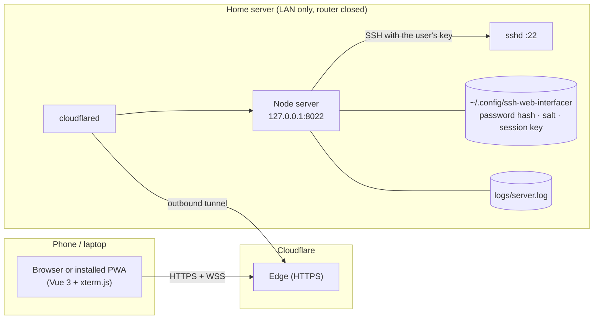

# Documentation

Developer documentation for **ssh-web-interfacer**: a password-protected, installable web terminal that reaches a home server's SSH through a Cloudflare Tunnel.

The top-level [README](../README.md) is the setup and usage guide. These pages explain how it works and why, for reviewing and extending the code.

| Page | Read it when you want to… |
| --- | --- |
| [Architecture](architecture.md) | understand the moving parts, how a request travels, and where every file fits |
| [Protocol](protocol.md) | see the exact HTTP API and WebSocket messages between browser and server |
| [Security](security.md) | review the threat model, each protection, and the known trade-offs |
| [Code review guide](code-review-guide.md) | walk the code file by file with a checklist and the known issues |
| [Testing](testing.md) | run the end-to-end checks used during development (mock SSH server, curl, WebSocket scripts) |
| [Operations](operations.md) | deploy, update, rotate secrets, read logs, troubleshoot |
| [Roadmap: multi-server hub](roadmap-multi-server.md) | plan the expansion to many servers managed from one place |

## Five-minute summary



1. **One Node process** (`server/`) serves the built Vue app, a small JSON API and a WebSocket at `/ws`.
2. **`cloudflared`** dials out to Cloudflare and forwards the public hostname to that process, so no router port is opened.
3. The user passes **two gates**: a site **password** (a signed session cookie afterwards), then an **SSH private key** chosen in the browser, which is used for one SSH login and never stored.
4. The WebSocket carries keystrokes in and terminal output out. The server bridges it to an interactive `ssh2` shell.
5. Every security-relevant event goes to `logs/server.log`, and `scripts/show-warnings.sh` summarises it.

## Repository map

```
server/               Node backend (ES modules, no build step)
  index.js            HTTP app, API routes, static files, WebSocket upgrade
  terminal.js         WebSocket ⇄ SSH shell bridge (one per connection)
  auth.js             password check, signed session tokens, cookies
  secrets.js          reads/creates files in SECRETS_DIR
  ratelimit.js        per-IP failure counters (login and SSH)
  logger.js           INFO/WARN/ALERT log file with rotation
  config.js           .env loading and validated settings
web/                  Vue 3 PWA (Vite root)
  index.html
  public/             favicon, PWA icons
  src/
    main.js           app bootstrap
    App.vue           screen state machine: login → connect → terminal
    api.js            fetch wrappers for /api/*
    pwa.js            service worker registration, install prompt
    style.css         glass design tokens and shared styles
    components/
      LoginCard.vue       password screen
      ConnectCard.vue     username + private key + passphrase
      TerminalWindow.vue  xterm.js + WebSocket client
      KeyBar.vue          extra keys for touch devices
      InstallButton.vue   PWA install button / iOS hint
scripts/              operator shell scripts
  set-password.sh     set/reset password (salted SHA-256)
  show-warnings.sh    review WARN/ALERT log events
  quick-tunnel.sh     free trycloudflare.com test deployment
  setup-tunnel.sh     permanent named tunnel + DNS
deploy/               systemd user service
cloudflared/          named-tunnel config example
vite.config.js        build + PWA manifest/service worker + dev proxy
docs/                 you are here
```
