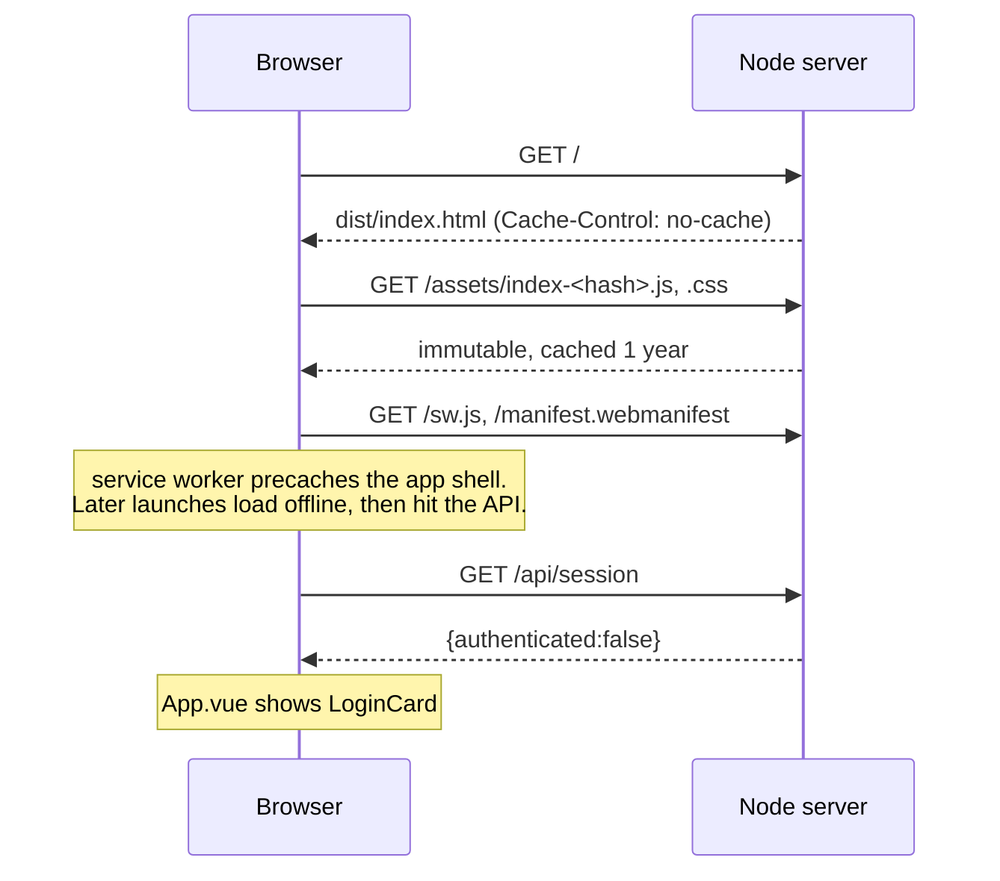
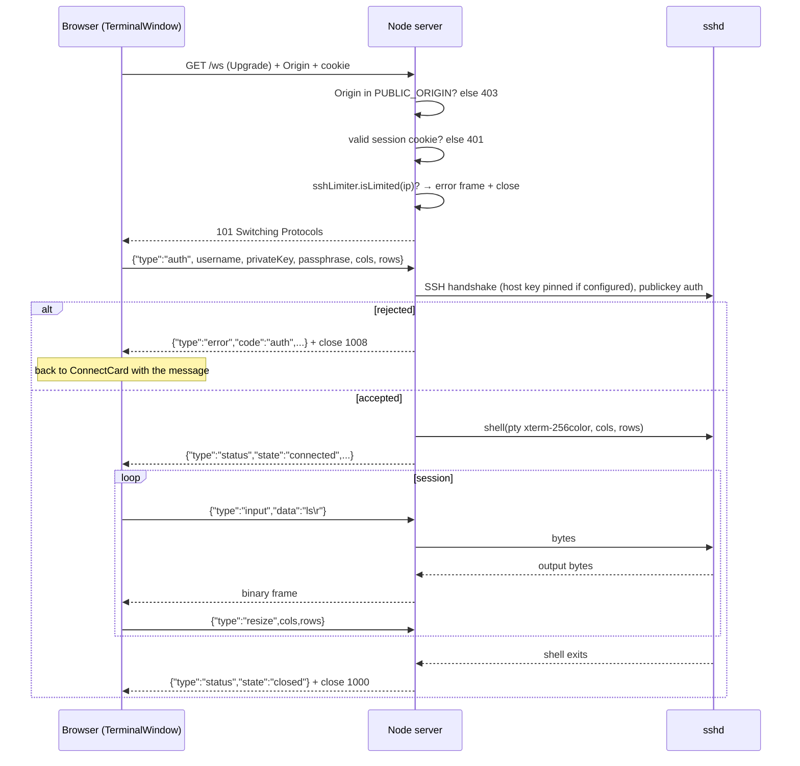
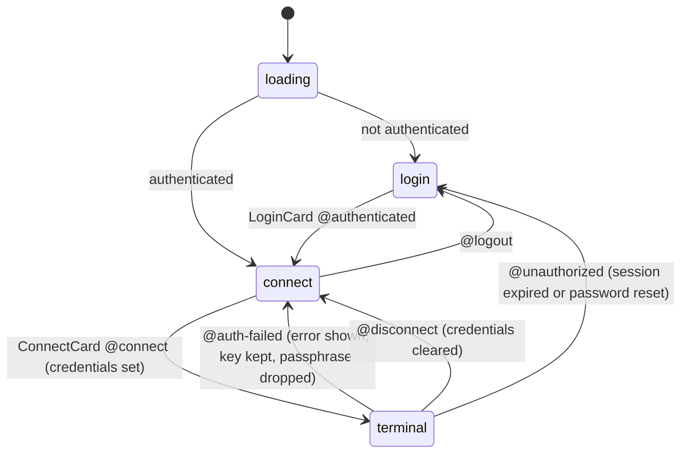
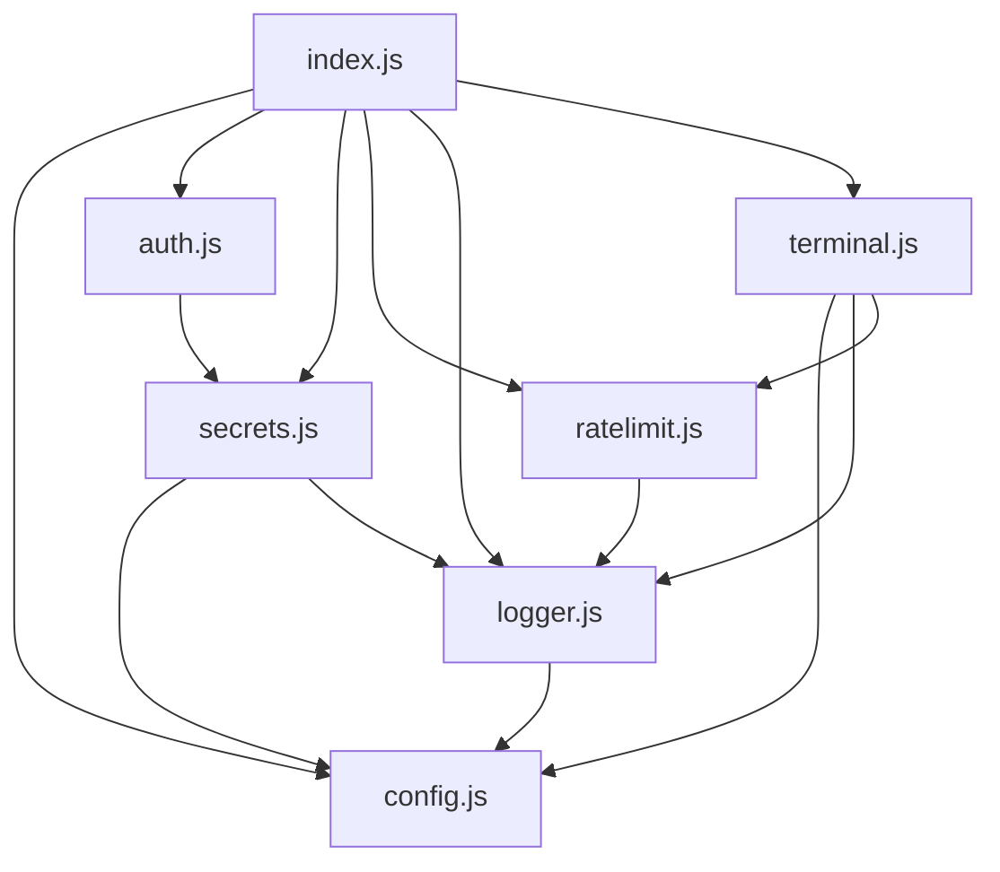

# Architecture

## Components

| Component | Runs where | Responsibility |
| --- | --- | --- |
| **Frontend** (`web/`) | the visitor's browser | UI, password form, key picker, terminal rendering (xterm.js), PWA shell |
| **Node server** (`server/`) | home server, `127.0.0.1:8022` | serves `dist/`, login API, session cookies, WebSocket ⇄ SSH bridge, rate limiting, logging |
| **cloudflared** | home server | outbound tunnel; maps `https://<hostname>` to `http://127.0.0.1:8022` |
| **sshd** | home server (or any host reachable from it) | the actual login and shell; trusts keys via `~/.ssh/authorized_keys` |
| **Cloudflare edge** | Cloudflare | TLS termination, DNS, optional Cloudflare Access in front |

There is deliberately **one** process serving both the page and the API. Same origin means a strict `SameSite=Strict` cookie works, no CORS, and a simple CSP (`'self'`).

## Request flows

### 1. Loading the app



### 2. Password login

```mermaid
sequenceDiagram
  participant B as Browser
  participant N as Node server
  participant D as SECRETS_DIR
  B->>N: POST /api/login {password}
  N->>N: loginLimiter.isLimited(ip)? → 429
  N->>D: read password.salt, password.sha256
  N->>N: sha256(salt + password) == stored? (timingSafeEqual)
  alt wrong
    N->>N: log WARN, loginLimiter.fail(ip) (5th → ALERT)
    N-->>B: 401 {error}
  else right
    N->>N: token = base64url({exp,nonce}) + "." + HMAC(session.key, payload + "." + passwordHash)
    N-->>B: 200 + Set-Cookie swi_session=token; HttpOnly; Secure; SameSite=Strict
  end
  B->>N: GET /api/session
  N-->>B: {authenticated:true, host, defaultUsername}
  Note over B: App.vue shows ConnectCard
```

### 3. Opening a terminal



Message formats are specified in [protocol.md](protocol.md).

## Frontend state machine

`App.vue` owns three pieces of state: `state` (`loading | login | ready`), `session` (from `/api/session`) and `credentials` (in-memory only, a `shallowRef`).



`connect` and `terminal` both have `state === 'ready'`. The difference is whether `credentials` is set and not marked `failed`.

Things that survive a reload:

| Data | Where | Lifetime |
| --- | --- | --- |
| session cookie | browser cookie jar (HttpOnly) | `SESSION_TTL_HOURS` or until password reset |
| last username | `localStorage['swi:username']` | until cleared |
| font size | `localStorage['swi:font-size']` | until cleared |
| private key, passphrase | JS memory only | until Disconnect, Log out, tab close or reload |

## Server modules and dependencies



`config.js` is imported first everywhere (directly or transitively) and loads `.env` as a side effect. Real environment variables win over `.env`, which is how `quick-tunnel.sh` overrides `PUBLIC_ORIGIN`.

Runtime dependencies are intentionally few: `express`, `ws`, `ssh2`. Everything crypto-related uses `node:crypto`.

## PWA

Configured in `vite.config.js` through `vite-plugin-pwa` (Workbox `generateSW`):

- `registerType: 'prompt'`: a new version shows an **Update** toast (`App.vue`) instead of reloading under a live shell.
- Precache: the built JS, CSS, HTML, SVG and PNG files (the app shell).
- `navigateFallbackDenylist: [/^\/api\//, /^\/ws/]`: API calls and the WebSocket always go to the network.
- The server sends `Cache-Control: no-cache` for `index.html`, `sw.js` and the manifest, so updates are noticed. Hashed `/assets/*` are `immutable`.
- `web/src/pwa.js` captures `beforeinstallprompt` (Chrome/Edge/Android) and detects iOS, which has no prompt API, so `InstallButton.vue` shows "Share → Add to Home Screen" there.

## Configuration surfaces

| Where | What | In git? |
| --- | --- | --- |
| `.env` | ports, `PUBLIC_ORIGIN`, SSH target, paths, TTL | no (`.env.example` is) |
| `SECRETS_DIR` (`~/.config/ssh-web-interfacer`) | `password.salt`, `password.sha256`, `session.key` | no, outside the repo |
| `LOG_DIR` (`logs/`) | `server.log`, rotated `server.log.1..5` | no (git-ignored) |
| `cloudflared/config.yml` | named tunnel ingress | no (generated) |
| `~/.ssh/authorized_keys` | which keys may log in | no, system file |
