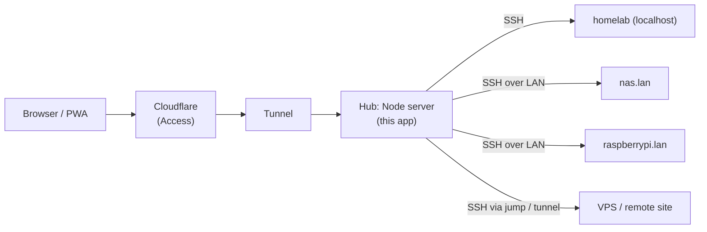
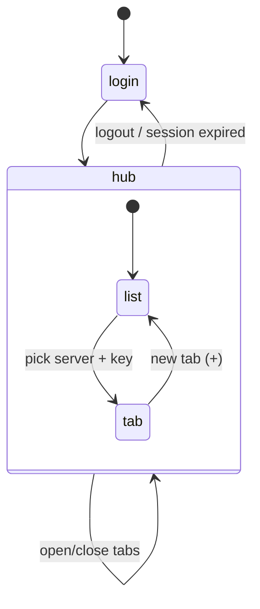

# Roadmap: multi-server hub

Goal: turn this single-server terminal into a **hub** where servers are added modularly and managed from one place, while keeping the current security properties.

Nothing here is implemented yet. This is a design to review before building.

## What changes conceptually

Today the SSH target is one fixed host from `.env` (`SSH_HOST`, `SSH_PORT`, `SSH_HOST_KEY_SHA256`). In the hub, the home server running this app becomes a **gateway**. It already sits on the LAN, so it can reach any machine there over SSH without extra tunnels.



## Phase 1: server registry (backend)

Replace the single `config.ssh` with a registry file in `SECRETS_DIR` (or a non-secret config dir), not in git:

```jsonc
// ~/.config/ssh-web-interfacer/servers.json
{
  "servers": [
    {
      "id": "homelab",                     // stable slug, used in URLs/logs
      "name": "Homelab",
      "host": "127.0.0.1",
      "port": 22,
      "hostKeySha256": "V2+5W6GJ…",        // required for non-localhost hosts
      "defaultUsername": "vitto",
      "allowedUsers": ["vitto"],           // optional allowlist
      "tags": ["home"],
      "icon": "server"
    },
    { "id": "nas", "name": "NAS", "host": "192.168.15.20", "port": 22, "hostKeySha256": "…", "defaultUsername": "admin" }
  ]
}
```

Changes:

| File | Change |
| --- | --- |
| `server/servers.js` (new) | load and validate `servers.json` (schema check, unique ids, `hostKeySha256` required except for loopback), reload on file change, `getServer(id)` |
| `server/config.js` | keep `SSH_*` as a fallback: if no `servers.json`, synthesise one entry, so existing installs keep working |
| `server/index.js` | `GET /api/servers` (authenticated) returns `id, name, tags, icon, defaultUsername` and **not** host/port unless needed |
| `server/terminal.js` | `auth` frame gains `serverId`. Look up the server, enforce `allowedUsers`, and use its host/port/hostVerifier. Add `server=<id>` to every log line. |
| `server/ratelimit.js` | key SSH failures by `ip + serverId` (and keep a global per-IP cap) |
| `scripts/add-server.sh` (new) | interactive: name, host, port. It fetches the host key with `ssh-keyscan`, shows the fingerprint for confirmation, and appends to `servers.json`. |

Protocol change (backwards-compatible: a missing `serverId` means the first server):

```jsonc
{ "type": "auth", "serverId": "nas", "username": "admin", "privateKey": "…", "cols": 120, "rows": 40 }
```

## Phase 2: hub UI (frontend)

- **Server list** after login: glass cards in a grid (or a sidebar on desktop) with name, tags, icon and a status dot.
- **Tabs**: several terminals open at once, each with its own `TerminalWindow` and WebSocket. Tab title is `user@server`, and the active tab is preserved on rotate/resize. Note: hidden tabs must not call `fit()` (already handled by the `offsetParent` check).
- **Per-server memory**: last username per `serverId` in `localStorage`.
- **Key reuse within a tab session**: pick a key once, use it for several servers (still memory-only).
- Component split: `ServerList.vue`, `ServerCard.vue`, `TabBar.vue`, and `TerminalWindow` takes a `server` prop.



## Phase 3: management features

Pick based on need. Each is a small module that receives an authenticated `ssh2` client for a server:

| Feature | How | Notes |
| --- | --- | --- |
| **Status / health** | TCP connect to `host:port` every N s, without logging in | cheap, no credentials; shows online/offline dots |
| **Quick metrics** | `ssh.exec('uptime; df -h /; free -m')` on demand | needs credentials, so it runs only while a key is loaded |
| **File browser / upload / download** | `ssh2` SFTP (`client.sftp()`) | stream files over the existing WebSocket or a separate authenticated HTTP endpoint |
| **Saved snippets** | per-server command list, sent as `input` | stored in `localStorage` or server-side |
| **Wake-on-LAN** | send a magic packet from the hub | needs the MAC in `servers.json` |
| **Port forwarding** | `client.forwardOut` → expose an internal web UI through the hub | powerful; needs careful auth and a strict allowlist |

A modular backend shape for these:

```js
// server/modules/<name>.js
export default {
  id: 'metrics',
  // Called with an already-authenticated ssh2 Client for one server.
  async run(client, server, params) { /* … */ },
};
```

`terminal.js` would become one such module (the interactive one). A generic `/ws` router would dispatch `{ type: 'module', module: 'metrics', serverId }` requests.

## Key management options

With many servers, choosing a key file every time gets tedious. Options, from simplest to most robust:

1. **Status quo:** pick a key per tab. Most secure, least convenient.
2. **Encrypted key in the browser:** store the private key in IndexedDB, encrypted with WebCrypto (AES-GCM) under a key derived from a PIN/passphrase (PBKDF2). It never leaves the device unencrypted at rest, but XSS on the page could still use it while it's unlocked. The CSP makes that hard.
3. **WebAuthn / passkeys for the site login** instead of (or alongside) the password. It's phishing-resistant and works with Face ID / fingerprint.
4. **SSH certificates (recommended at scale):** run a small SSH CA on the hub. After the site login (plus 2FA), the hub signs a **short-lived certificate** (e.g. 1 hour) for a key generated for that session. Every server trusts the CA once via `TrustedUserCAKeys` in `sshd_config`, so there's no `authorized_keys` sprawl and revocation is mostly unnecessary because certs expire. This is a bigger change: the hub then holds the CA key, which becomes the crown jewel (keep it in `SECRETS_DIR`, `600`, ideally passphrase-protected or in a hardware token).

## Reaching servers outside the LAN

- **Jump host:** the hub already is one. Use `ssh2`'s `sock` option with a `forwardOut` stream from a first connection (the equivalent of `ProxyJump`).
- **Cloudflare tunnels on remote sites:** run `cloudflared` there with an SSH ingress, and connect from the hub using `cloudflared access tcp` or Cloudflare WARP private networking.
- **Tailscale / WireGuard** between sites: the simplest option. The hub then sees remote servers as if they were on the LAN.

## Security implications of becoming a hub

- The hub's blast radius grows: compromising it means reaching every server. **Make Cloudflare Access mandatory** (SSO + 2FA), and consider WebAuthn for the site login.
- Require `hostKeySha256` for every non-loopback server, so a LAN MITM can't capture keys.
- Per-server `allowedUsers` (consider refusing `root`).
- Audit log: `server=<id>` on every event. Consider logging session start/end and total bytes (never the content).
- Rate limits per server **and** per IP.
- Revisit the [known limitations](security.md#known-limitations): server-side session revocation and a slower password hash become more valuable.

## Suggested order of work

1. Phase 1 registry + `serverId` in the protocol, with the `.env` fallback. Ship with a single entry, so nothing changes for the user.
2. `scripts/add-server.sh` with host key pinning.
3. Server list UI + per-server usernames.
4. Tabs.
5. Health dots.
6. Then decide on key management (option 2 or 4) based on how many servers there are.

Each step is independently shippable and testable with the mock SSH server from [testing.md](testing.md) (run several on different ports).
