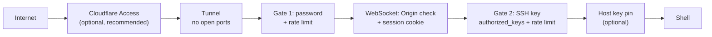

# Security

This app puts a shell on the internet, so it is worth reviewing with an attacker's mindset. This page lists what is protected, how, and what isn't.

## Assets

| Asset | Where it lives | Impact if lost |
| --- | --- | --- |
| Shell access to the server | sshd | full compromise of the user account |
| SSH private keys | user devices; briefly in browser memory and Node memory during a connection | attacker can log in wherever that key is authorised |
| Site password | user's head; hash in `SECRETS_DIR/password.sha256` | attacker passes gate 1 |
| `session.key` | `SECRETS_DIR` | attacker can mint session cookies (gate 1 only) |
| Logs | `logs/` | privacy (IPs, user agents); tampering hides attacks |

## Attackers considered

1. **Internet stranger** who finds the hostname (DNS, certificate transparency logs, link sharing).
2. **Malicious website** the user visits while logged in (CSRF, cross-site WebSocket hijacking).
3. **Network observer** between device and Cloudflare.
4. **Someone with the user's unlocked device** for a short time.
5. **Local user/process on the home server** (out of scope for most controls; see limitations).

## Layers

## Controls, and where they live in the code

| # | Control | Defends against | Code |
| --- | --- | --- | --- |
| 1 | Server binds `127.0.0.1` only. The tunnel is outbound, and the router stays closed | direct access, port scans | `config.js` (`HOST`), `cloudflared` |
| 2 | TLS end to end to Cloudflare | network observers | Cloudflare |
| 3 | Password gate, salted SHA-256, constant-time compare | strangers | `auth.js → verifyPassword`, `scripts/set-password.sh` |
| 4 | Login rate limit: 5 failures per IP per 15 min, then 429 | online password guessing | `ratelimit.js`, `index.js /api/login` |
| 5 | Session cookie: HMAC-signed, `HttpOnly`, `Secure`, `SameSite=Strict`, expiry | XSS cookie theft, CSRF, forgery | `auth.js` |
| 6 | Sessions bound to the password hash, so a reset logs everyone out | stolen cookies after a reset | `auth.js → sign` |
| 7 | WebSocket requires an allowed `Origin` **and** a valid session | cross-site WebSocket hijacking | `index.js` upgrade handler |
| 8 | SSH key from the user per connection, never persisted or logged | server-side key theft | `terminal.js`, `ConnectCard.vue`, `App.vue` |
| 9 | SSH auth rate limit (5 per IP per 15 min), covering bad keys and passphrases | brute force through the tunnel | `ratelimit.js`, `terminal.js` |
| 10 | Username allowlist regex | injection into logs/ssh | `terminal.js USERNAME_RE` |
| 11 | Optional SSH host key pin | a swapped or MITM'd SSH target | `terminal.js → hostVerifier`, `SSH_HOST_KEY_SHA256` |
| 12 | Strict CSP: `script-src 'self'`, `frame-ancestors 'none'`, no third-party code | XSS key exfiltration, clickjacking | `index.js` `csp` |
| 13 | `X-Content-Type-Options`, `Referrer-Policy: no-referrer`, `COOP` | MIME sniffing, URL leaks | `index.js` |
| 14 | Request limits: 4 KB JSON bodies, 64 KB WebSocket frames, clamped PTY sizes | resource abuse | `index.js`, `terminal.js` |
| 15 | Log sanitisation: control characters replaced, values quoted | log forging / injection | `logger.js → clean` |
| 16 | Secrets outside the repo, dir `700`, files `600` | accidental commits, other local users | `secrets.js`, `set-password.sh` |
| 17 | `.gitignore` covers `.env*`, keys, `logs/`, tunnel credentials | accidental commits | `.gitignore` |

### Why CSRF is not an issue for the API

- `POST /api/login` needs `Content-Type: application/json`. A cross-site form can't send that without a CORS preflight, which the server never approves.
- The session cookie is `SameSite=Strict`, so the browser never attaches it to cross-site requests.
- WebSockets aren't covered by SameSite or CORS in all browsers, so the **Origin check (7)** is the real defence there. Don't remove it.

### Why the key goes to the server

Browsers can't open raw TCP connections, so something has to speak SSH on the browser's behalf. Here that's the Node server. The key exists in Node memory for the duration of one `ssh2` connection.

A malicious or compromised server process could therefore capture keys. Mitigations: use a **dedicated key per device**, with a **passphrase**, optionally restricted with `from="127.0.0.1,::1"` in `authorized_keys`. An alternative design that keeps keys out of the server is discussed in the [roadmap](roadmap-multi-server.md#key-management-options).

## Known limitations

These are deliberate trade-offs or open items. Review them when changing the related code.

1. **SHA-256 is a fast hash.** If `password.sha256` and `password.salt` leak, a weak password can be brute-forced offline quickly. Use a long passphrase. A future improvement is `scrypt` or Argon2 (Node has `crypto.scrypt`), but both `set-password.sh` and `auth.js` would need to change together.
2. **Logout doesn't revoke the token server-side.** It only clears the cookie. A copied token stays valid until it expires. Resetting the password (or rotating `session.key`) is the kill switch.
3. **Rate limits live in memory.** They reset when the server restarts, and the `Map` isn't swept: entries are only removed when that IP is seen again after the window. Many distinct IPs grow memory slowly. Fine for a homelab; use a periodic sweep or an LRU if it ever matters.
4. **`CF-Connecting-IP` is trusted unconditionally.** That's safe only because the server listens on loopback. If `HOST` is changed to a LAN address, LAN clients could spoof the header to dodge rate limits and fake log IPs. To change `HOST`, first only trust the header when `req.socket.remoteAddress` is loopback.
5. **The password travels to the server in plaintext inside TLS.** That's standard for web logins. Hashing on the client wouldn't help: the hash would just become the password.
6. **One password for everyone.** No per-user accounts, 2FA or WebAuthn. Cloudflare Access provides SSO and 2FA in front.
7. **`style-src 'unsafe-inline'`** is needed by xterm.js. Scripts are still locked to `'self'`.
8. **Quick tunnels can't be protected by Cloudflare Access.** They're for testing only.
9. **Logs contain IPs and user agents** (personal data in some jurisdictions). They're local, mode `640`, and rotated at 5 MB × 5. Nothing deletes them by age.

## Review checklist for security-relevant changes

- [ ] Does any new endpoint return data or act without `isAuthenticated(req)`?
- [ ] Does anything new log a request body, key, passphrase or password?
- [ ] Do client-supplied values reaching `log.*` go through fields (sanitised), not interpolated into the message?
- [ ] Is the WebSocket `Origin` check still before `handleUpgrade`?
- [ ] Does new frontend code load anything from a third-party origin (it would break the CSP, and it shouldn't)?
- [ ] Do new failure paths call the relevant limiter's `fail(ip)`?
- [ ] If the password format changes, are `set-password.sh` and `auth.js` still byte-compatible?
- [ ] Are new secret files created with mode `600` inside `SECRETS_DIR`?
